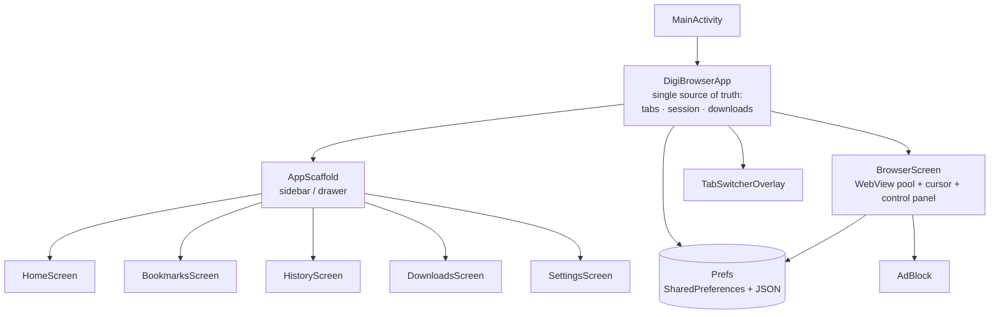

<div align="center">

# 🌐 Digi Browser

**A lightweight, remote-friendly web browser for Android TV, tablets, and phones.**
Built 100% with Kotlin + Jetpack Compose on top of the system WebView.


<!-- Add screenshots here -->
 

</div>

---

## ✨ Why Digi Browser?

Most mobile browsers are made for fingers. Digi Browser is made for **the couch**:
a living-room browser you can drive with nothing but a TV remote, that still feels
at home on a phone.

| | |
|---|---|
| 🎮 **Remote-first** | Full D-pad navigation, focus rings everywhere, and an on-screen **cursor** so you can click any link on any website. |
| 📱 **Adaptive layout** | One codebase, two layouts: sidebar-drawer on phones, wide TV layout with a tabs button in the header on large screens. |
| ⚡ **Instant tab switching** | Tabs keep their own live WebView (LRU pool), so switching never reloads the page, while memory stays bounded. |
| 🧠 **Memory-aware** | Background tabs are saved and released automatically when RAM is low (fewer live WebViews on TV / low-RAM devices). |
| 🛡️ **Safe defaults** | Invalid HTTPS certificates are blocked, pop-ups and ads/trackers can be blocked, WebView debugging is debug-builds only. |

---

## 🚀 Features

### Browsing
- Search or type a URL (auto-detects URL vs. search query)
- Search engines: **Google, Bing, Yahoo, DuckDuckGo**
- Back / Forward / Reload / Home control panel (opens with the remote's **Back** key)
- **Desktop / Mobile** site toggle per session, remembered
- Secure / not-secure indicator (HTTPS vs. HTTP)
- Error page with the real reason instead of a blank screen

### Tabs
- Tab switcher with live **previews** (4:3 cards), `CLEAR · ⊕ · DONE` pill
- Tabs are **saved automatically** and restored after the app is closed
- Same tab list on Home, sidebar, and Browser (single source of truth)
- Up to **20 tabs**, with an LRU pool of 2–3 live WebViews

### Library
- ⭐ **Bookmarks**, 🕘 **History** (can be turned off), ⬇️ **Downloads** (with install/open for APKs)
- Home **shortcuts**: add, edit, reorder, delete, with custom emoji and color

### Privacy & control
- Lightweight host-based **ad & tracker blocker**
- **Pop-up blocker**
- JavaScript toggle, history toggle

---

## 🎮 Controls

| Input | Action |
|---|---|
| D-pad | Move the on-screen cursor / move focus |
| OK / Enter | Click under the cursor / activate focused item |
| Back | Open the control panel · Back again closes it · with no history returns Home |
| Panel → ⌃ tabs hint | Focus the hint and press OK/↓ to open the tab switcher |
| Tab switcher | D-pad to move · OK to open · `CLEAR` closes all · `+` new tab |
| Touch | Normal WebView gestures, drawer menu on phones |

---

## 🏗️ Architecture




**Design rules used across the project**
- No hardcoded UI text → everything lives in `res/values/strings.xml` (English; ready for translations)
- No hardcoded colors in screens → `DigiColors`
- No magic numbers / URLs → `BrowserConfig`

---

## 🛠️ Build & run

**Requirements**
- Android Studio (recent stable, with AGP 9.x support)
- JDK 17+
- Android SDK 37

```bash
git clone https://github.com/Appsventory/Digi-TvBrowser.git
cd Digi-TvBrowser
./gradlew assembleDebug          # debug APK
./gradlew installDebug           # install on a connected device / emulator
```

Run on an **Android TV emulator** (API 34+) or a real TV via `adb connect <tv-ip>:<port>`.

### Release build
1. Create your own keystore (**never commit it**) and add a `signingConfig` locally.
2. `./gradlew assembleRelease` (R8 shrinking is enabled, so test the release build).

---

## 🔐 Permissions

| Permission | Why |
|---|---|
| `INTERNET`, `ACCESS_NETWORK_STATE` | Browsing |
| `WRITE_EXTERNAL_STORAGE` (Android ≤ 9 only) | Saving downloads on old devices |
| `REQUEST_INSTALL_PACKAGES` | Install a downloaded APK when you tap it |

Cleartext (`http://`) traffic is allowed because a browser must open any site; HTTPS certificate errors are **blocked**, not bypassed.

---

## 🗺️ Roadmap

- [ ] Persist tab previews and per-tab history across app restarts
- [ ] Cross-device tab sync (needs an account / backend)
- [ ] Incognito tabs
- [ ] Translations (`values-id`, …)
- [ ] Unit / UI tests

---

## 🤝 Contributing

Issues and pull requests are welcome. 

---

<div align="center">

<strong>Made with ~~Vibe coding~~ [♥︎] by ~~Mulya Saputra~~ & ICK Network Team </strong>

</div>