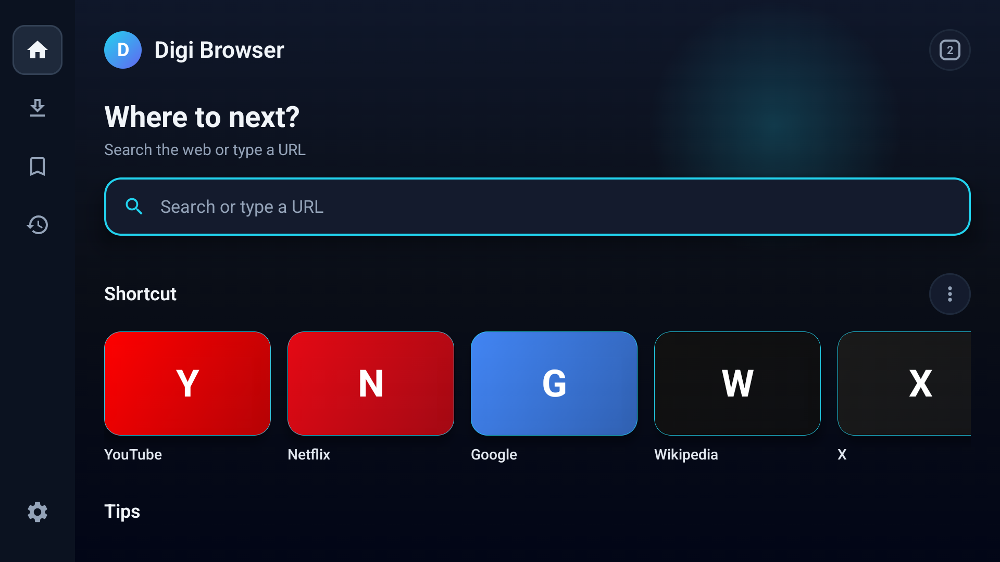
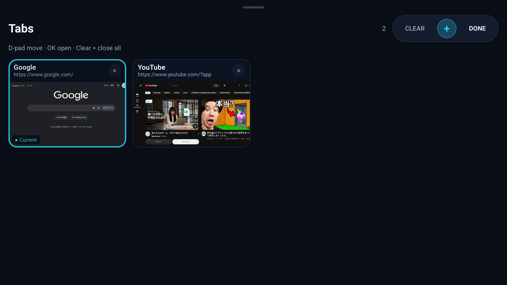
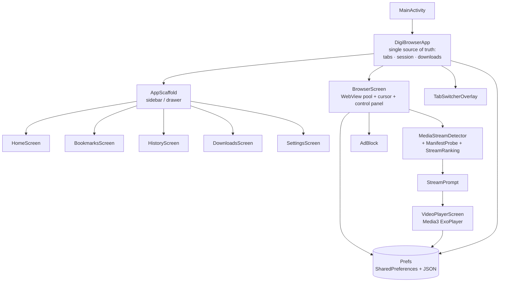

# 🌐 Digi Browser

**A lightweight, remote-friendly web browser for Android TV, tablets, and phones.** Built 100% with Kotlin + Jetpack Compose on top of the system WebView.


<p>
  
  
</p>

---

## ✨ Why Digi Browser?

Most mobile browsers are made for fingers. Digi Browser is made for **the couch**:
a living-room browser you can drive with nothing but a TV remote, that still feels
at home on a phone.

| | |
|---|---|
| 🎮 **Remote-first** | Full D-pad navigation, focus rings everywhere, and an on-screen **cursor** so you can click any link on any website. |
| 🎬 **Native video player** | Detects the video a page is playing and offers to open it in a built-in Media3 player with quality, subtitles, speed and full remote control. |
| 📱 **Adaptive layout** | One codebase, two layouts: sidebar-drawer on phones, wide TV layout with a tabs button in the header on large screens. |
| ⚡ **Instant tab switching** | Tabs keep their own live WebView (LRU pool), so switching never reloads the page, while memory stays bounded. |
| 🧠 **Memory-aware** | Background tabs are saved and released automatically when RAM is low (fewer live WebViews on TV / low-RAM devices). |
| 🛡️ **Safe defaults** | Invalid HTTPS certificates are blocked, pop-ups and ads/trackers can be blocked, WebView debugging is debug-builds only. |

---

## 🚀 Features

### Browsing
- Search or type a URL (auto-detects URL vs. search query), with **suggestions** as you type: your bookmarks and history first, then the selected search engine's
- Search engines: **Google, Bing, Yahoo, DuckDuckGo**
- Back / Forward / Reload / Home control panel (opens with the remote's **Back** key)
- **Desktop / Mobile** site toggle per session, remembered
- Secure / not-secure indicator (HTTPS vs. HTTP)
- Error page with the real reason instead of a blank screen
- **Page fullscreen**: in-page players (including DRM sites that run inside the WebView) get a real full-screen view with system bars hidden

### Tabs
- Tab switcher with live **previews** (4:3 cards), `CLEAR · ⊕ · DONE` pill
- Tabs are **saved automatically** and restored after the app is closed
- Same tab list on Home, sidebar, and Browser (single source of truth)
- Up to **20 tabs**, with an LRU pool of 2–3 live WebViews

### 🎬 Native video player
When a page loads a video, Digi Browser shows a **"Video detected"** card:
**Play in app** or **Play in browser**. The player is a full-screen Compose screen
(not a separate Activity) powered by **Media3 / ExoPlayer**.

- **Detection**: HLS (`.m3u8`), DASH (`.mpd`), progressive files (`.mp4 .m4v .webm .mkv .mov .ogv .3gp`) and side-loadable subtitles (`.vtt`, `.srt`) seen by `shouldInterceptRequest`, plus `currentSrc` / `<source>` / `<track>` read from the page and same-origin iframes
- **Main video vs. ads**: manifests are probed in the background (duration, resolution, live), clips under 60 s are treated as ads/previews, and the stream that matches the page's playing `<video>` is ranked first
- **Stream list**: a button inside the player lists *every* stream found on the page with thumbnail, file name, URL, size, duration and type, so a wrong guess is one click away from being fixed
- **Same identity as the browser**: `User-Agent`, `Referer`, `Origin` and per-request **cookies** from the WebView are forwarded, so authenticated streams play
- **Quality**: Auto + every available resolution, switchable while playing
- **Subtitles**: embedded tracks and side-loaded `.vtt`/`.srt`, with a language picker and **timing nudge** (±0.1 s; side-loaded files only)
- **Extras**: speed 0.5×–2×, aspect modes (Fit / Fill / Zoom / 16:9 / 4:3), **resume** from the last position, **Picture-in-Picture** (Android 8+, including Android TV)

### App updates
- **Settings → About** shows the installed version with a live status chip: *checking · up to date · update available (vX.Y.Z)*
- Opening the version row opens the **update page**: installed vs latest version, **release notes from GitHub** (rendered Markdown), and one-tap **download + install** of the release APK (progress bar, also listed in Downloads)
- Source is the GitHub Releases API of this repo; the check is throttled (once per 10 min) and never blocks the UI

### Library
- ⭐ **Bookmarks**, 🕘 **History** (can be turned off), ⬇️ **Downloads** (with install/open for APKs)
- Home **shortcuts**: add, edit, reorder, delete, with custom emoji and color

### Privacy & control
- Host-based **ad & tracker blocker**
- **Strong ad blocking** (separate toggle, on by default): pop-under / push / native-ad networks, third-party ad URL patterns (VAST, IMA, prebid …), hidden ad containers, `window.open` without a user gesture, and ad streams kept out of video detection. May break some sites, so it can be switched off
- **Pop-up blocker**
- JavaScript toggle, history toggle

---

## 🎮 Controls

### Browser

| Input | Action |
|---|---|
| D-pad | Move the on-screen cursor / move focus |
| OK / Enter | Click under the cursor / activate focused item |
| Back | Open the control panel · Back again closes it · with no history returns Home |
| Panel → ⌃ tabs hint | Focus the hint and press OK/↓ to open the tab switcher |
| Tab switcher | D-pad to move · OK to open · `CLEAR` closes all · `+` new tab |
| Page fullscreen | ←/→ seek · OK play/pause · ↑/↓ speed · **MENU** switches to a cursor (D-pad moves it, OK taps the page's own controls) |
| Video card | OK on **Play in app** / **Play in browser** · Back dismisses it · panel **Video** button brings it back |
| Touch | Normal WebView gestures, drawer menu on phones |

### Video player

| Input | Action |
|---|---|
| ← / → | Seek ±10 s (hold: ±30 s) |
| OK / Enter | Play / pause |
| ↑ / ↓ | Show controls and move between them |
| Media keys | Play, pause, fast-forward, rewind, stop always work |
| Back | Close the open menu, then leave the player |
| Touch | Tap = show/hide controls · double-tap left/right = ∓10 s · drag the seek bar |

---

## 🏗️ Architecture



**Video player package layout**

| Package | Role |
|---|---|
| `player/` | Detection (`MediaStreamDetector`), manifest probe, ranking, ExoPlayer factory (headers + cookies), subtitle parser, thumbnails, PiP glue, JS bridge |
| `ui/player/` | `VideoPlayerScreen`, controls, menus, stream list, state mirror of the player |
| `ui/browser/` | `StreamPrompt` ("Video detected"), `FullscreenWebVideo` (page fullscreen) |

More detail: [`docs/VIDEO_PLAYER.md`](docs/VIDEO_PLAYER.md).

**Design rules used across the project**

- No hardcoded UI text → everything lives in `res/values/strings.xml` (English; ready for translations)
- No hardcoded colors in screens → `DigiColors`
- No magic numbers / URLs → `BrowserConfig` (browser) and `PlayerConfig` (player)

---

## 🛠️ Build & run

**Requirements**

- Android Studio (recent stable, with AGP 9.x support)
- JDK 17+
- Android SDK 37

```bash
git clone https://github.com/Appsventory/Digi-TvBrowser.git
cd Digi-TvBrowser
./gradlew assembleDebug          # debug APK
./gradlew installDebug           # install on a connected device / emulator
```

Run on an **Android TV emulator** (API 34+) or a real TV via `adb connect <tv-ip>:<port>`.

**Dependencies** are managed in `gradle/libs.versions.toml`. The player uses
`androidx.media3` (`exoplayer`, `exoplayer-hls`, `exoplayer-dash`, `ui`), version `media3`.

### Release build
1. Create your own keystore (**never commit it**) and add a `signingConfig` locally.
2. `./gradlew assembleRelease` (R8 shrinking is enabled, so test the release build).

---

## 🔐 Permissions

| Permission | Why |
|---|---|
| `INTERNET`, `ACCESS_NETWORK_STATE` | Browsing, video playback and the update check |
| `WRITE_EXTERNAL_STORAGE` (Android ≤ 9 only) | Saving downloads on old devices |
| `REQUEST_INSTALL_PACKAGES` | Install a downloaded APK when you tap it |

Cleartext (`http://`) traffic is allowed because a browser must open any site; HTTPS certificate errors are **blocked**, not bypassed.

---

## ⚠️ Known limitations (video)

- Detection reads URLs the page itself loads. Streams delivered as `blob:` (MSE) and DRM-protected content (e.g. Widevine) cannot be handed to the native player; they keep playing inside the page, and **Page fullscreen** still works for them.
- Cross-origin iframes are not readable from JavaScript; their streams are only caught when they show up as network requests.
- Subtitle **timing nudge** works for side-loaded `.vtt`/`.srt` only, not for tracks embedded in the stream.
- Stream-list thumbnails: no DASH previews; encrypted HLS segments and servers that refuse app requests show a placeholder. File size is only known for progressive files.
- Some servers bind a stream URL to the page session or a single use; those can answer `403` outside the WebView.

---

## 🗺️ Roadmap

- [ ] Persist tab previews and per-tab history across app restarts
- [ ] Cross-device tab sync (needs an account / backend)
- [ ] Incognito tabs
- [ ] Translations (`values-id`, …)
- [ ] Unit / UI tests (detector, manifest probe, subtitle parser are pure and easy to cover first)
- [ ] Live-updating stream list while the player is open
- [ ] Background update check with a notification

---

## 🤝 Contributing

Issues and pull requests are welcome.

---

**Made with ~~Vibe coding~~ [♥︎] by ~~Mulya Saputra~~ & ICK Network Team**
